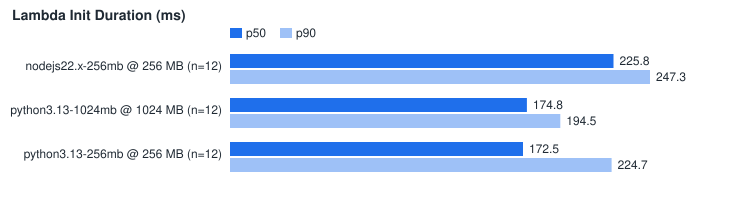

# lambda-cold-start-bench

Measure AWS Lambda cold starts: summarise the `REPORT` lines from your logs offline, or force cold starts on a function you own and collect the numbers.

**Status:** early but working. `analyze` (offline log statistics, CSV, SVG chart) and `run` (force cold starts on an existing function) are implemented and tested. Deploying throwaway test functions per runtime is not built yet. The `run` command has only been exercised against a stubbed Lambda client, never against a real AWS account; see [Limitations](#limitations).

## Install

```bash
pip install git+https://github.com/narayana006/lambda-cold-start-bench            # analyze only, no dependencies
pip install "lambda-cold-start-bench[aws] @ git+https://github.com/narayana006/lambda-cold-start-bench"   # adds boto3 for `run`
```

Python 3.10 or newer.

## Quick start (offline, no AWS account)

Clone the repository and point `analyze` at the sample logs. The files in `examples/` are synthetic: they have the exact shape of Lambda's log lines but the numbers were generated, not measured.

```bash
lambda-cold-start-bench analyze examples/*.log --csv summary.csv --chart init-duration.svg
```

Output of that command, run on the files in this repository:

```text
144 invocations, 36 cold starts, 108 warm. Times in ms.

label              mem MB  cold n  init p50  init p90  init p99  init max  cold dur p50  warm n  warm dur p50  warm dur p90  max mem MB
-----------------  ------  ------  --------  --------  --------  --------  ------------  ------  ------------  ------------  ----------
nodejs22.x-256mb      256      12     225.8     247.3     292.8     298.4          27.4      36           8.3          16.3          75
python3.13-1024mb    1024      12     174.8     194.5     252.3     259.4           9.4      36           2.4           6.4          53
python3.13-256mb      256      12     172.5     224.7     274.7     280.7          22.7      36           6.8          19.2          52
wrote summary.csv
wrote init-duration.svg
```

The chart it wrote ([examples/init-duration.svg](examples/init-duration.svg)):



## `analyze`: statistics from log files

```bash
lambda-cold-start-bench analyze [LABEL=]FILE [[LABEL=]FILE ...] [--csv PATH] [--chart PATH]
```

Each file is any text that contains Lambda `REPORT` lines, for example saved output of `aws logs tail` or `aws logs filter-log-events`, or a copy from the CloudWatch console. Other lines are ignored, and a prefix before `REPORT` (timestamp, stream name) is fine.

What is read from each line:

| Field | Meaning here |
| --- | --- |
| `Init Duration` | Only present when the invocation started a new execution environment. Its presence is what marks an invocation as a cold start. |
| `Duration` | Handler time, reported separately for cold and warm invocations. |
| `Billed Duration` | Mean per group, in the CSV. |
| `Memory Size` | Results are grouped by label and memory size. |
| `Max Memory Used` | Highest value in the group. |

The JSON `platform.report` record that Lambda writes for functions using the JSON log format is read as well.

- The label is the file name without its extension, or whatever you put before `=` (`checkout=logs/a.txt`).
- Percentiles use linear interpolation between the two nearest ranks (the same definition as numpy's default). With only a handful of cold starts, p99 is effectively the maximum; look at `cold n` before trusting a tail number.
- `--csv` writes one row per group with min, mean, p50, p90, p99 and max of Init Duration plus the duration columns. `--chart` writes an SVG with Init Duration p50 and p90 bars.

To compare runtimes, memory sizes or architectures, collect one log file per configuration and pass them all.

## `run`: force cold starts on an existing function

> **Read this before using `--apply`.** `run --apply` **invokes your function** (with the payload you give it, `{}` by default) and **changes its configuration**. For every cold start it calls `UpdateFunctionConfiguration` on `$LATEST`, setting `MemorySize` and rewriting the environment variables with one extra variable, `COLD_START_BENCH_NONCE`. That configuration change is what forces the next invocation to start a new execution environment. Consequences:
>
> - Any other traffic hitting `$LATEST` during the run also gets cold starts, and runs at the benchmark's memory size while one is being tested.
> - Your function really runs, with whatever side effects it has. Use a function and payload for which that is safe.
> - Invocations and the extra duration are billed to your account.
> - The original memory size and environment variables are written back at the end, also when the run fails part-way. The tool restores the values it read at the start, so do not deploy or edit the function while a run is in progress: such a change to memory or environment variables would be overwritten.
> - If the restore itself fails (for example the process is killed), the function is left with the last tested memory size and the `COLD_START_BENCH_NONCE` variable. The error message says what to set back, and a later run refuses to start while that variable is present.
>
> Point it at a test function, not at something serving production traffic.

Without `--apply` the command is a dry run: it makes one read-only call and prints the plan.

```bash
lambda-cold-start-bench run --function my-fn --count 10 --memory 256,1024            # dry run
lambda-cold-start-bench run --function my-fn --count 10 --memory 256,1024 --apply    # really runs
```

| Option | Default | |
| --- | --- | --- |
| `--function` | required | Function name or ARN. Only `$LATEST` is benchmarked. |
| `--count` | 10 | Cold starts per memory size. |
| `--memory` | current size | Comma-separated memory sizes in MB to compare. |
| `--warm` | 0 | Extra invocations after each cold start, to get warm durations for comparison. |
| `--payload-file` | `{}` | File with the event to send. |
| `--save-log` | | Write the collected `REPORT` lines to a file that `analyze` can read later. |
| `--csv`, `--chart` | | Same as for `analyze`. |
| `--region`, `--profile` | boto3 defaults | |
| `--apply` | off | Without it nothing is changed or invoked. |

Timings come from the `REPORT` line in the log tail that Lambda returns with a synchronous invocation (`LogType=Tail`), so the numbers are Lambda's own, not client-side wall-clock time, and they do not include network time to the API.

### Example output (stubbed client)

This is the real output of `python examples/stubbed_run.py`. That script runs the CLI with `--count 3 --memory 256,1024 --apply` against a boto3 client wrapped in botocore's `Stubber`, so every response is canned and nothing reaches AWS. The timings are invented; the point is to show what a run prints.

```text
Function:        demo-fn (python3.13)
ARN:             arn:aws:lambda:us-east-1:123456789012:function:demo-fn
Current memory:  256 MB
Memory sizes:    256 MB, 1024 MB
Plan:            7 configuration updates (the last one restores the original), 6 invocations
Each update sets MemorySize and rewrites the function's 2 environment variables plus COLD_START_BENCH_NONCE.

  256 MB cold: init 187.4 ms duration 23.1 ms
  256 MB cold: init 179.8 ms duration 21.8 ms
  256 MB cold: init 201.1 ms duration 25.0 ms
  1024 MB cold: init 172.1 ms duration 8.7 ms
  1024 MB cold: init 168.9 ms duration 9.1 ms
  1024 MB cold: init 175.7 ms duration 8.4 ms

Configuration restored to 256 MB with the original environment variables.

label    mem MB  cold n  init p50  init p90  init p99  init max  cold dur p50  warm n  warm dur p50  warm dur p90  max mem MB
-------  ------  ------  --------  --------  --------  --------  ------------  ------  ------------  ------------  ----------
demo-fn     256       3     187.4     198.4     200.9     201.1          23.1       0             -             -          49
demo-fn    1024       3     172.1     174.9     175.6     175.7           8.7       0             -             -          49
```

### IAM permissions

`analyze` needs none. `run` needs these actions on the function:

| Action | Used for | Needed for a dry run |
| --- | --- | --- |
| `lambda:GetFunctionConfiguration` | reading the current memory size and environment variables, and waiting for each update to finish | yes |
| `lambda:UpdateFunctionConfiguration` | forcing a cold start and restoring the original configuration | no |
| `lambda:InvokeFunction` | the measured invocations | no |

Environment variable values are read and written back but never printed or saved.

## Features

- [x] Parses `REPORT` lines (Init Duration, Duration, Billed Duration, Memory Size, Max Memory Used), plain text and JSON `platform.report`
- [x] Cold versus warm statistics per label and memory size: min, mean, p50, p90, p99, max
- [x] Compares runtimes, memory sizes and architectures from one log file per configuration
- [x] CSV output and an SVG chart
- [x] Forces cold starts on an existing function and records init and invoke durations; dry run by default
- [x] Restores the function's memory size and environment variables when finished
- [ ] Deploys small test functions for each runtime and configuration
- [ ] Removes deployed test functions when finished
- [ ] Package size as a benchmark dimension
- [ ] SnapStart (`Restore Duration`) support

## Limitations

- `run` is tested only with botocore's `Stubber` (the exact sequence of API calls, the restore on failure, and the output). It has not been run against a live AWS account, so treat the first real run with care and try the dry run first.
- `run` works on an existing function's `$LATEST`. It does not create functions, and it cannot benchmark a published version or an alias, because their configuration cannot be changed.
- An invocation is counted as cold only if its `REPORT` line has an `Init Duration`. If an invocation right after a configuration update reports none, the tool warns and counts it as warm rather than guessing.
- SnapStart functions report a restore time instead of an init time; that is not parsed, so those invocations show up as warm.
- `Init Duration` is the time Lambda reports for initialising the runtime and your code outside the handler. It is not the full latency a caller sees on a cold start.
- The sample logs in `examples/` are synthetic. Do not quote them as benchmark results.
- Charts are SVG only.

## Development

```bash
git clone https://github.com/narayana006/lambda-cold-start-bench
cd lambda-cold-start-bench
python -m venv .venv && . .venv/bin/activate
pip install -e ".[dev]"
pytest
```

The tests set dummy AWS credentials and use `Stubber`; they never contact AWS.

## Contributing

Issues and pull requests are welcome. Real `REPORT` lines that the parser gets wrong are especially useful: include the line (with the request ID changed if you like) in the issue.

Built and maintained by [Narayana Vemburaj](https://github.com/narayana006).

## License

[MIT](LICENSE)
